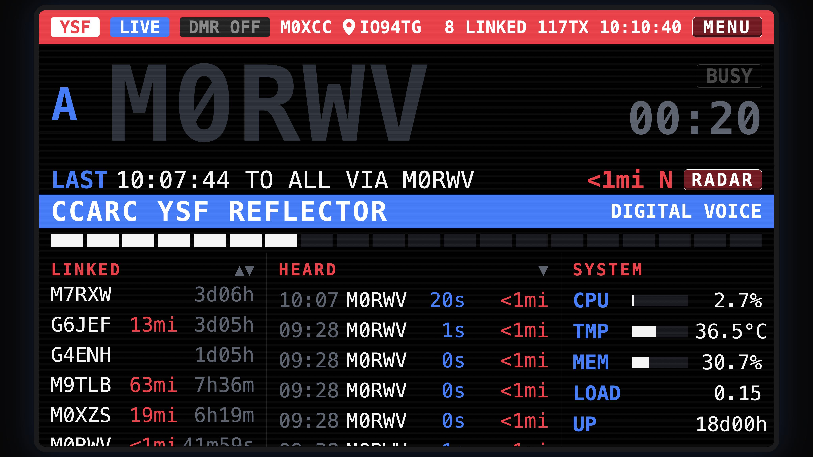
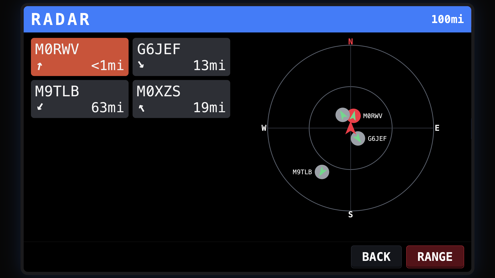
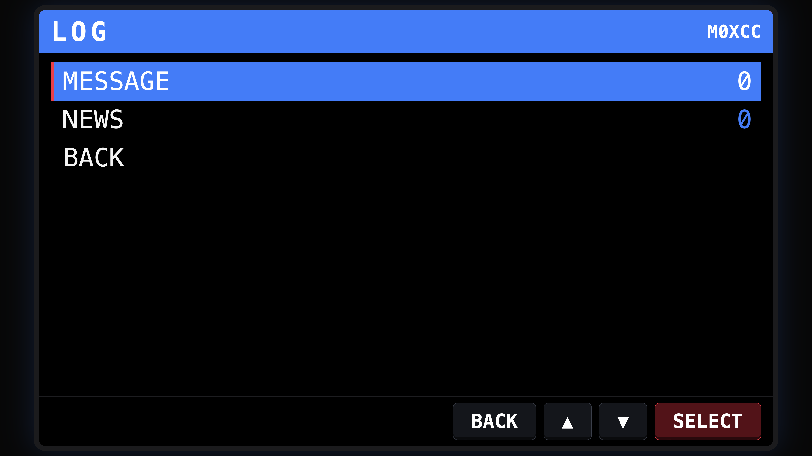
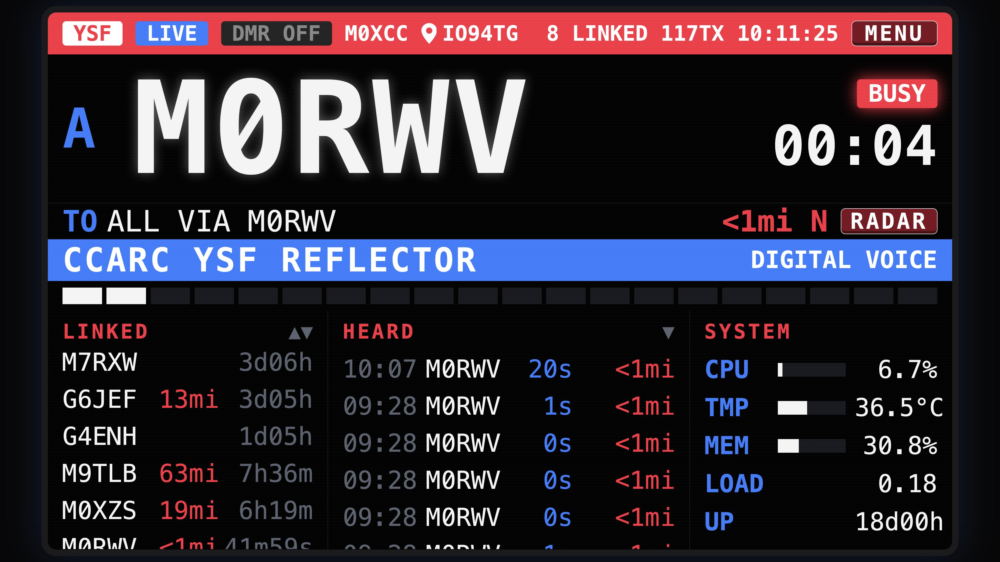

# YSF-XTRA

Extras for a YSF (Yaesu System Fusion) reflector: a radio-style web dashboard, a documented decoder for the text messages and GPS positions that Yaesu C4FM radios send through it, and a News Station that answers WIRES-X news requests with text messages and keeps uploads from your users.

Python 3.5+, standard library only. Written for a Raspberry Pi 3B+ running pYSFReflector; works on any Linux host that can read the reflector log.

<table>
<tr>
<td></td>
<td></td>
</tr>
<tr>
<td align="center"><sub>Dashboard: last heard, linked gateways, system status</sub></td>
<td align="center"><sub>RADAR: heard stations by distance and bearing</sub></td>
</tr>
<tr>
<td></td>
<td></td>
</tr>
<tr>
<td align="center"><sub>MENU &gt; LOG: messages and News Station uploads</sub></td>
<td align="center"><sub>Dashboard while a station is transmitting</sub></td>
</tr>
</table>

## Status: work in progress, open exploration

YSF-XTRA is a work in progress and an open exploration. It records what Yaesu System Fusion (C4FM) radios actually send through a YSF reflector, and builds a few useful functions on top of that: a dashboard, message and position decoding, and a News Station. The aim is to help others develop more YSF-based functions on top of C4FM.

- Everything here was observed and tested on the author's own equipment (see "Tested on"). Other radios, firmware versions and reflector software may behave differently.
- Expect rough edges. Features, file formats and options may change.
- Captures from other radios, corrections, fixes and new ideas are welcome as issues and pull requests.

## Quick start

This gets the dashboard running first, then adds the optional parts one at a time. Check each step before moving on.

**You need:** a Linux host (a Raspberry Pi is fine) running a YSF reflector on the same machine (tested with pYSFReflector; the decoder only needs the reflector's UDP port, the dashboard needs its log files), Python 3.5 or later, systemd, `git` and `sudo`.

### Values you will set

| What | Where | Example |
|---|---|---|
| Node or club callsign shown on the dashboard | `ysfradio.service`: `--node` | `N0CALL` |
| Reflector name on the banner | `ysfradio.service`: `--name` | `"My YSF Reflector"` |
| Your locator, for distance and RADAR | `ysfradio.service`: `--grid` (or `--lat` and `--lon`) | `IO91` |
| Reflector log folder | `ysfradio.service`: `--log-dir` | `/var/log/YSFReflector` |
| Time-out the talk meter counts to, in seconds | `ysfradio.service`: `--tot` (default 60) | `180` |
| Reflector UDP port | `ysfmsg.service`: `--port` | `42002` |
| News Station room ID | `ysfmsg.service`: `--board-room-id` | `12345` |
| Callsign the News replies are sent as | `ysfnews.service`: `--call` | `N0CALL` |
| 5-character radio ID the News replies are sent as | `ysfnews.service`: `--radio-id` | `12345` |
| Public host name (HTTPS only) | `ysfradio.service`: `--public-host` | `reflector.example.org` |

Use your own callsign and radio ID, or your club's. Nothing is sent under any other identity.

### 1. Get the code and create the user and folders

```
git clone https://github.com/forshaws/YSF-XTRA.git
cd YSF-XTRA
sudo useradd -r -s /usr/sbin/nologin ysfdash
sudo mkdir -p /opt/ysfdash /var/lib/ysfradio
sudo chown ysfdash:ysfdash /var/lib/ysfradio
sudo chmod 750 /var/lib/ysfradio
sudo cp src/*.py /opt/ysfdash/
```

The dashboard runs with group `adm` so it can read the reflector logs. Check that the files in your log folder are readable by that group (`ls -l /var/log/YSFReflector`) and change `Group=` in the unit if your system differs.

### 2. The dashboard (plain HTTP first)

Create the service, then edit the callsign, name and locator:

```
sudo tee /etc/systemd/system/ysfradio.service >/dev/null <<'EOF'
[Unit]
Description=YSF Reflector radio-style dashboard
After=network.target

[Service]
User=ysfdash
Group=adm
ExecStart=/usr/bin/python3 /opt/ysfdash/ysfradio.py --log-dir /var/log/YSFReflector --host 0.0.0.0 --port 8080 --node N0CALL --name "My YSF Reflector" --grid IO91 --aprs --messages --positions --news
Restart=on-failure
NoNewPrivileges=true
ProtectSystem=strict
ProtectHome=true
PrivateTmp=true
ReadWritePaths=/var/lib/ysfradio

[Install]
WantedBy=multi-user.target
EOF
sudoedit /etc/systemd/system/ysfradio.service      # --node, --name, --grid
sudo systemctl daemon-reload
sudo systemctl enable --now ysfradio
curl -s http://127.0.0.1:8080/healthz
```

The last command prints `ok`. Open `http://<your-host>:8080/` in a browser: you should see the banner with your name and callsign, the linked gateways, and the last heard list filling as stations transmit. If the page says the log is stale, check `--log-dir` and the file names (`YSFReflector-YYYY-MM-DD.log`; `--prefix` changes the first part).

`--aprs` looks up positions of heard stations on APRS-IS (read-only) for the distance display. Remove it if the host has no internet access.

### 3. Admin PIN (needed for the admin functions)

```
sudo -u ysfdash python3 /opt/ysfdash/ysfradio.py --make-pin
sudo systemctl restart ysfradio
```

Choose 6 to 12 digits. MENU > ADMIN then unlocks the delete keys on the message and news lists.

### 4. HTTPS (before exposing the dashboard to the internet)

Use a real certificate (for example from Let's Encrypt). For a local test, a self-signed one:

```
sudo mkdir -p /opt/ysfdash/certs
sudo openssl req -x509 -newkey rsa:2048 -nodes -days 365 -subj "/CN=reflector.example.org" \
     -keyout /opt/ysfdash/certs/privkey.pem -out /opt/ysfdash/certs/fullchain.pem
sudo chown -R ysfdash:ysfdash /opt/ysfdash/certs
sudo chmod 600 /opt/ysfdash/certs/privkey.pem
```

Then use `systemd/ysfradio.service` from this repository as the template. It already has the settings for ports 443 and 80, the certificate paths and the `CAP_NET_BIND_SERVICE` line. Edit `--node`, `--name`, `--grid`, `--public-host` and the certificate paths, copy it to `/etc/systemd/system/`, and run `sudo systemctl daemon-reload && sudo systemctl restart ysfradio`. Its `--base /dash` serves the dashboard under `/dash/`; remove it to serve from `/`.

### 5. Messages and radio positions

```
sudo cp systemd/ysfmsg.service /etc/systemd/system/
sudoedit /etc/systemd/system/ysfmsg.service        # --port must match your reflector's UDP port
sudo systemctl daemon-reload
sudo systemctl enable --now ysfmsg
journalctl -u ysfmsg -f
```

Leave `--board-room-id 00000` for now. This service watches the reflector's UDP port on the same machine and never transmits. Send a text message from a radio on the reflector: the log shows `stored message N`, and MENU > LOG > MESSAGE shows it. Radio positions from voice and from GPS-attached messages appear as distance and RADAR entries.

### 6. News Station (optional)

A radio's News Station "download, message" is answered with the lines of `news.txt`, then the latest uploads; "upload, message" is stored for later downloaders.

1. **Capture a template message.** The News replies need the frame headers of a real text message from your radio. Connect the radio to your reflector with GPS position off, run the capture, send a short text message (for example `HELLO`) from the radio, then press Ctrl+C:

   ```
   sudo python3 src/ysfcap.py --call YOURCALL --label HELLO --out cap_HELLO.jsonl
   python3 src/ysfsend.py --check cap_HELLO.jsonl
   ```

   `YOURCALL` is your radio's callsign. The check should print `ALL 7 MATCH the capture byte for byte`. If it says no complete 7-frame GPS-off transmission was found, repeat the capture with the radio's GPS position switched off.

2. **Find your News Station room ID.** Run a capture, press News Station, UPLOAD and send a message from the radio, then Ctrl+C. The last record shows `id='NNNNN'`:

   ```
   sudo python3 src/ysfcap.py --call YOURCALL --label UPLOAD --out up.jsonl
   python3 src/ysfdec.py --records up.jsonl
   ```

3. **Install the files and edit the units.**

   ```
   sudo cp examples/news.txt /var/lib/ysfradio/news.txt
   sudo cp cap_HELLO.jsonl /var/lib/ysfradio/news-template.jsonl
   sudo chown ysfdash:ysfdash /var/lib/ysfradio/news.txt /var/lib/ysfradio/news-template.jsonl
   sudo cp systemd/ysfnews.service /etc/systemd/system/
   sudoedit /etc/systemd/system/ysfmsg.service     # --board-room-id NNNNN
   sudoedit /etc/systemd/system/ysfnews.service    # --call and --radio-id
   sudo systemctl daemon-reload
   sudo systemctl restart ysfmsg
   sudo systemctl enable --now ysfnews
   ```

4. **Test.** On the radio: WIRES-X, News Station, DOWNLOAD, Message. The reply messages arrive in the radio's message log within a few seconds. `journalctl -u ysfnews -f` shows each request. Adding `--dry-run` to the `ysfnews.service` command logs what would be sent without sending anything.

Edit `/var/lib/ysfradio/news.txt` at any time (one message per line, 80 characters at most, `{call}` becomes the requester's callsign); no restart is needed. `docs/README-news.md` has the options and the board tool.

### 7. Pictures from camera microphones (optional)

Pictures sent from a Yaesu radio with a camera microphone can be kept and shown in the dashboard (MENU > LOG > PICTURES). Only senders on a whitelist are kept. See `docs/C4FM-PICTURE-FORMAT.md`.

```
sudoedit /etc/systemd/system/ysfmsg.service     # add: --pictures-dir /var/lib/ysfradio/pictures
sudoedit /etc/systemd/system/ysfradio.service   # add: --pictures
sudo systemctl daemon-reload
sudo systemctl restart ysfmsg ysfradio
```

Add senders in the dashboard: MENU > PIC SENDERS (admin PIN), ADD SENDER with the callsign and, optionally, the radio ID. The list is stored in `/var/lib/ysfradio/picture-allow.json`. A callsign with no radio ID matches any radio. Pictures from other callsigns are ignored and logged once. Kept pictures: 20 at most, 7 days, 5 per callsign per hour, 64 KB each. A picture with a lost frame is kept and marked DAMAGED. An admin can delete a picture with DEL.

Radios cannot yet download pictures from the News Station; this is receive and display only.

While a picture or text message is being received, the dashboard shows DATA on the lamp, PICTURE DATA (or MESSAGE DATA) on the blue bar and PICTURE TO (or MESSAGE TO) on the route line, then returns to DIGITAL VOICE. `ysfmsgd.py` writes `/var/lib/ysfradio/activity.json` for this (`--activity-out`, empty = off); the dashboard ignores it when older than 6 seconds.

### 8. DMR X-link toggle (optional)

Only for a reflector bridged to DMR with MMDVM_Bridge. See `docs/README-menu.md`.

### Upgrading

```
cd YSF-XTRA && git pull
sudo cp src/*.py /opt/ysfdash/
sudo systemctl restart ysfmsg ysfnews ysfradio
```

Keep your own `.service` files; only compare them with the ones in `systemd/`. Restarting `ysfradio` logs the admin out.

### If something does not work

| Symptom | Check |
|---|---|
| Dashboard empty or "stale" | `--log-dir`, `--prefix`, and that the log files are readable by group `adm` |
| No messages or positions | `ysfmsg` is active, `--port` matches the reflector, `journalctl -u ysfmsg` |
| No reply to a News download | `journalctl -u ysfnews`; the template file exists; the same radio is answered once per 2 minutes |
| Uploads not stored | `--board-room-id` is the room ID from step 6.2 |
| HTTPS fails to start | Certificate and key paths and ownership; ports 443 and 80 free |

## What is in it

**Dashboard** (`src/ysfradio.py`, built on `src/ysfdash.py` and `src/ysfmenu.py`)

- Now talking, last heard, linked gateways, top callers; HTTPS with a strict content security policy.
- MENU: DMR X-link toggle (admin PIN), my location (node or the visitor's own GPS), distance unit.
- Distance and bearing to heard stations, and a RADAR view, from APRS-IS positions and from positions the radios themselves transmit.
- MENU > LOG > MESSAGE: the last 20 broadcast text messages, newest first, with an unread icon in the top bar.
- MENU > LOG > NEWS: the News Station uploads kept on the reflector (see below).
- Admin (PIN): a `DEL` key on the MESSAGE and NEWS lists deletes the selected item.

**Decoder** (`src/ysfmsgd.py`, `src/ysfdec.py`, `src/ysfpos.py`)

- Reads the reflector's UDP port with a kernel packet filter (needs `CAP_NET_RAW`, never transmits).
- Decodes broadcast text messages and the position carried in GPS-attached messages and in voice transmissions.
- Writes `messages.json` and `positions.json` for the dashboard. Directed message text is discarded unread.
- With `--pictures-dir`, assembles pictures from camera microphones (`src/ysfpic.py`) and keeps those from whitelisted senders.
- Also recognises WIRES-X News Station requests: a download request is queued for `ysfnews.py`, and an upload (a text addressed to the News Station room ID) is kept as a public news item.

**News Station responder** (`src/ysfnews.py`, `docs/README-news.md`)

- A radio's News Station "download, message" is answered with the lines of `news.txt` (`examples/news.txt` is a generic welcome to edit), then the latest uploads from other radios, as directed text messages under your own callsign and radio ID. The radio shows them in its message log.
- A radio's "upload, message" is stored on the reflector, so stations that connect later can download it, like a small bulletin board. At most 20 items for 30 days, 3 per callsign per hour.
- Voice and picture downloads are not answered.

**Research tools** (`src/`)

| Tool | Purpose |
|---|---|
| `ysfcap.py` | Passive capture of the frames sent by one callsign to a JSON lines file |
| `ysfdec.py` | Frame, FICH, data unit and record decoder (`--records`, `--ok`, `--selftest`) |
| `ysfdiff.py` | Shows which bytes change between repeated captures |
| `ysfsend.py` | Builds and sends one text message, broadcast or directed (`--to-call`, `--to-id`), under your own callsign (`--check`, `--dry`, `--live`) |
| `ysfpos.py` | Decodes and builds the APRS Mic-E position block |
| `ysfgps.py` | Lists decoded positions in a capture and compares them with positions you set |
| `ysfreplay.py` | Feeds a capture through the decoder and records the positions in it |

**Operator tools** (`src/`)

| Tool | Purpose |
|---|---|
| `ysfboard.py` | List, add, edit, delete and clear News Station board items (`sudo -u ysfdash python3 /opt/ysfdash/ysfboard.py list`) |

## Documentation

| File | Content |
|---|---|
| `docs/C4FM-TEXT-MESSAGE-FORMAT.md` | The text message format, frame coding, checksum, addressing, GPS block, voice position |
| `docs/C4FM-PICTURE-FORMAT.md` | The camera microphone picture format: records, chunks, check sums, receiving |
| `docs/LIMITS-AND-TIMEOUTS.md` | Rate limits, retention and timers, with the option that sets each |
| `docs/README-ysfdash.md` | The original read-only dashboard (`ysfdash.py`) |
| `docs/README-menu.md` | MENU, DMR toggle, location, distance and RADAR; install and options |
| `docs/README-messages.md` | LOG > MESSAGE, LOG > NEWS, admin delete, radio positions; install, options, what is kept |
| `docs/README-news.md` | News Station responder: download, upload, news file, board tool; install and options |
| `docs/GPS-TEST-PLAN.md` | The controlled test used to decode the GPS block |

## Web endpoints (GET and HEAD only)

| Path | Returns |
|---|---|
| `/` | Dashboard page |
| `/api/status` | JSON: now talking, linked gateways, last heard, top callers, positions, menu state |
| `/api/messages` | JSON: the last 20 broadcast messages, newest first (`--messages`) |
| `/api/news` | JSON: the News Station uploads, newest first (`--news`) |
| `/api/pictures` | JSON: the kept pictures, newest first (`--pictures`) |
| `/pic/<id>.jpg` | A kept picture (`--pictures`) |
| `/healthz` | `ok` |

Admin actions (DMR toggle, `POST /api/delete` for messages, news items and pictures, `POST /api/picallow` for the picture sender whitelist) are POST requests behind the PIN, a session cookie and a CSRF header: see `docs/README-menu.md` and `docs/README-messages.md`.

## Security

- The dashboard process runs as an unprivileged user with `CAP_NET_BIND_SERVICE` only. The packet-capture process is separate and holds `CAP_NET_RAW` only.
- Text from radios is shown with `textContent`. There is no `innerHTML`, no inline script and no inline style, and the content security policy allows scripts and styles from the page's own origin only. Checked with hostile payloads in message text, callsigns and the positions file.
- Messages are limited to 80 printable ASCII characters, sender callsigns must match a strict pattern, positions must be numbers in range. At most 20 messages, 7 days, 10 per callsign per hour. News items: 20, 30 days, 3 per callsign per hour.
- The decoder only records what the radios transmit to the reflector, which is already visible to everyone connected to it. It stores the sender callsign, time, text and latest position per callsign (30 days). Directed messages are discarded unread; the only exception is a News Station upload, which is public by design.
- The News Station responder (`ysfnews.py`) is a separate service with no privileges. It answers only requests that name a valid callsign and radio ID, once per radio per 2 minutes and at most 30 requests an hour, and sends only under the callsign and radio ID you configure.
- Files shared between the services are changed under a lock, so simultaneous writes are not lost.
- YSF has no authentication: anyone can send a message or position under any callsign, as with APRS-IS. The dashboard shows what the packet says. If the reflector blocks or mutes a source, the decoder still sees that source's packets because it reads the port before the reflector decides.

## Tested on

FT5D (sending and receiving, voice and text, News Station upload and download), FT3D (receiving a generated text message), a Raspberry Pi 3B+ with Raspbian 9 and Python 3.5, with pYSFReflector as the reflector. Other reflector software, such as the G4KLX YSFReflector, is untested. Other radio models, other firmware, voice modes other than voice/data mode 2, and image or data messages are untested.

## Responsible use

Transmit only under your own callsign and licence conditions. `ysfsend.py` and `ysfnews.py` take the callsign and radio ID you give them: use your own. `ysfnews.py` sends messages automatically without an operator at the controls: check that your licence permits that before running it. Nothing here defeats encryption, signing or access control; none was found. Not affiliated with or endorsed by Yaesu Musen Co., Ltd. "Yaesu" and "System Fusion" are trademarks of their owners. No Yaesu firmware or confidential material was used; the formats were derived from the published C4FM air interface specification and from the author's own radios and reflector.

## Disclaimer of warranty and limitation of liability

THIS SOFTWARE AND DOCUMENTATION ARE PROVIDED "AS IS", WITHOUT WARRANTY OF ANY KIND, EXPRESS OR IMPLIED, INCLUDING BUT NOT LIMITED TO THE WARRANTIES OF MERCHANTABILITY, FITNESS FOR A PARTICULAR PURPOSE, ACCURACY, RELIABILITY, SECURITY AND NON-INFRINGEMENT. IN NO EVENT SHALL THE AUTHOR OR CONTRIBUTORS BE LIABLE FOR ANY CLAIM, DAMAGES OR OTHER LIABILITY, WHETHER IN AN ACTION OF CONTRACT, TORT OR OTHERWISE, ARISING FROM, OUT OF OR IN CONNECTION WITH THE SOFTWARE OR DOCUMENTATION, OR THE USE OF OR OTHER DEALINGS IN THEM. THIS INCLUDES, WITHOUT LIMITATION, LOSS OF DATA, LOSS OF SERVICE, DAMAGE TO EQUIPMENT, SECURITY INCIDENTS AND ANY ACTION BY A LICENSING OR REGULATORY AUTHORITY.

- **Use at your own risk.** You install, configure, run and expose this software entirely at your own risk. Back up your system first and test before relying on it.
- **Observed behaviour, not a specification.** The format documentation describes what was observed on the author's equipment. It is not an official specification, may be incomplete or wrong, and may not hold for other radios, firmware versions or reflector software.
- **No security guarantee.** The security notes describe design intent and the checks that were made. They are not a guarantee. Review the code and your configuration yourself before exposing any service to the internet. YSF has no authentication, so anything shown on the dashboard can be sent by anyone under any callsign.
- **Automatic transmissions.** `ysfnews.py` and `ysfsend.py` transmit over the radio network. You alone are responsible for complying with the licence conditions and the rules that apply to you and to the network you connect to, including station identification, permitted content, third-party traffic and unattended or automatic operation.
- **Data from users.** The software shows and stores callsigns, text and positions sent by other stations. You alone are responsible for moderating that content and for complying with privacy and data-protection law that applies to you.
- **Not for safety-critical use.** Do not rely on this software for emergency communications or any situation where failure could endanger people or property.
- **No support or obligation.** The author has no obligation to provide support, fixes or updates.
- **No affiliation.** This project is not affiliated with, endorsed by or sponsored by Yaesu Musen Co., Ltd., the YSF reflector software authors or any other third party. Product and company names are trademarks of their owners.
- **Law.** These terms apply to the fullest extent permitted by law. Nothing here excludes or limits any liability that cannot be excluded or limited by law. If anything here conflicts with the `LICENSE` file, the `LICENSE` file applies.

## Open source and credit

YSF-XTRA is open source, under the terms in the `LICENSE` file. If you use, adapt or build on this work (the code, the format documentation or the findings), please credit it in your project and in any release, article or talk, and keep the copyright and licence notice as the `LICENSE` file requires. For example:

> Based on YSF-XTRA by Scot Forshaw (M0RWV), https://github.com/forshaws/YSF-XTRA

Improvements are welcome back as pull requests, and so are captures and findings from other radios.

## Credits

Scot Forshaw (M0RWV). Based on captures made on the author's own equipment.

## Licence

See `LICENSE`.
